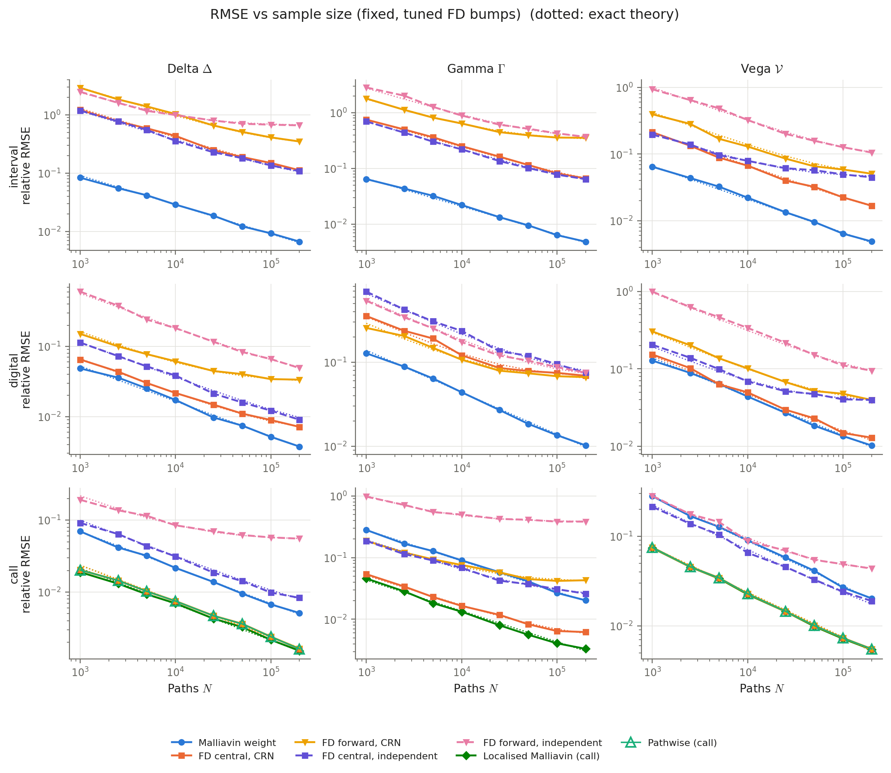
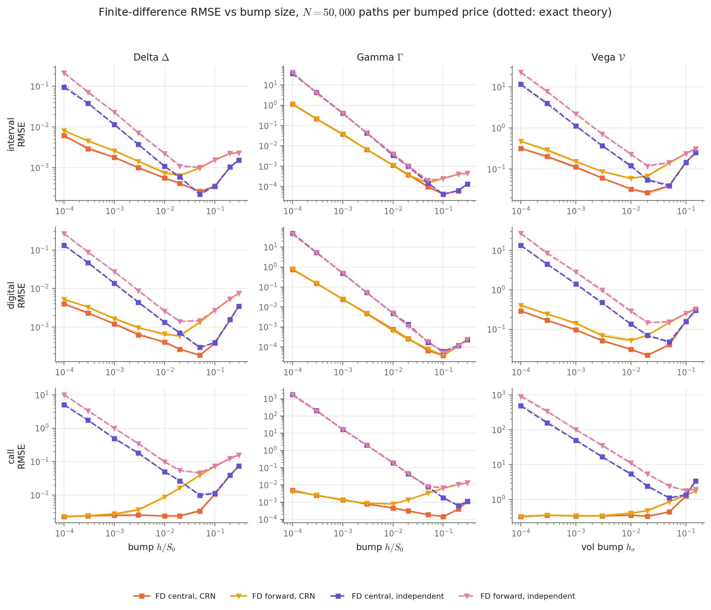
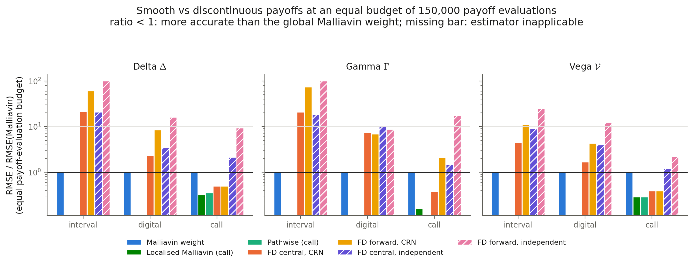

# Monte Carlo Greeks

**A comparative study of finite differences, pathwise differentiation and
Malliavin-calculus estimators for option sensitivities.**

Monte Carlo prices are easy, and Monte Carlo *Greeks* are not: bump-and-reprice
estimators trade truncation bias against simulation noise, and they break
down for discontinuous payoffs such as digital options. Fournié, Lasry,
Lebuchoux, Lions & Touzi (1999) showed that Greeks can be written as
`E[payoff × weight]`, where the weight comes from integration by parts on
Wiener space, does not depend on the payoff, and never requires
differentiating it.

This repository implements those estimators in the Black–Scholes model,
replicates the paper's numerical section, and runs a controlled statistical
comparison against finite differences (common vs independent random numbers)
and pathwise derivatives. It covers several payoffs, sample sizes, bump
sizes, volatilities, strikes and maturities, at equal computational budgets.
Every simulated quantity is checked against closed-form values, and every
estimator's variance against an exact quadrature value.

📄 **[Research report](docs/research_report.md)** · 🧮 **[Mathematical derivations](docs/mathematical_derivations.md)** · 🧪 **[Experimental design](docs/experimental_design.md)**

> **Note.** For terminal European payoffs in Black–Scholes, the Malliavin
> weights are *identical* to the likelihood-ratio (score) weights
> ([derivations §2.5](docs/mathematical_derivations.md)). "Malliavin weight"
> in the phase-1 results below means "Malliavin = LR weight".

**How the project has grown.** Phase 1 (the replication above) is documented
at the end of this page. The sections that follow describe Phases 2–7:
* **Phase 2:** path-dependent Asian digitals and conditional smoothing.
* **Phase 3:** quasi-Monte Carlo path constructions under real time budgets.
* **Phase 4:** pre-registered method selection and Greek-aware PCA.
* **Phase 5:** budget-feasible schedules, joint Greeks, reuse and a two-asset basket.
* **Phase 6:** a validated sampling baseline and a training-free rotation.
* **Phase 7:** volatility term structures and Chronos-2 volatility forecasts.

Every study since Phase 4 was pre-registered: its protocol was committed to
`configs/` before any result was computed.

## Phase 2: path-dependent digital Greeks and adaptive estimator selection

📋 [Audit](docs/PROJECT_AUDIT.md) · 📚 [Literature review](docs/LITERATURE_REVIEW.md) · 🧭 [Research gaps](docs/RESEARCH_GAPS.md) · 📝 [Proposal](docs/RESEARCH_PROPOSAL.md) · 🧪 [Methodology](docs/EXPERIMENTAL_METHODOLOGY.md) · 📊 **[Findings](docs/RESEARCH_FINDINGS.md)**

**Problem.** The discretely monitored Asian digital `e^{−rT}·1{(1/m)Σ S_{t_i} ≥ K}`
has no closed form. Phase 2 compares six estimator families on it, each
with plain MC or scrambled-Sobol RQMC:

* likelihood ratio (equal here to the FLLLT weight);
* an anticipating Malliavin Δ weight;
* conditional pathwise, integrating out the last increment;
* conditional pathwise, integrating out the first increment;
* bump-and-revalue on the raw payoff;
* bump-and-revalue on the smoothed payoff.

On top of these sits a pilot-based selector that picks an estimator per
contract under a fixed compute budget. It is evaluated out of sample,
against fixed rules and an oracle.

**Main results** (36 + 12 scenarios, m ∈ {4, 12, 52}; details and CIs in the
findings):

* **Rao–Blackwell guarantee.** Integrating out the *first* Gaussian increment
  gives a smooth, closed-form conditional estimator that is exactly the
  Rao–Blackwellised likelihood-ratio estimator for Δ and Γ. Its variance
  is therefore never higher, and in practice it was 5–3·10⁵× lower.
* **Last-step conditioning ("vibrato"-style) is a poor smoother for
  averages.** It was worse than plain LR in 46% (Δ) and 90% (Γ) of settings.
* **RQMC on top of smoothing.** Up to ~850× lower MSE at m = 4, but it loses
  at m = 52 with sequential construction (no Brownian bridge implemented).
* **A pilot-based adaptive selector did *not* beat a well-chosen fixed
  estimator.**
  * The naive version failed catastrophically, with up to 500× the oracle
    RMSE. Rare-event estimators produced zero-variance pilots and were
    selected.
  * A variance guard and a restricted candidate set looked "safe" in
    phase 2. *Corrected in phase 3:* once the pilot's measured wall time is
    charged, every adaptive variant is clearly worse than the best fixed
    estimator. The phase-2 accounting under-charged the pilot by 6–400×.
* The idea of conditional smoothing itself is prior art (Giles 2009;
  Zhang & Wang 2020); the contribution here is the controlled,
  cost-charged evaluation and its failure analysis.

```bash
cd scripts
```

```bash
python asian_study.py --config quick
```

```bash
python asian_study.py --config research
```

```bash
python asian_study.py --config confirm
```

The research run takes about 40 minutes and the confirmation run about 5.
Outputs go to `results/asian/<config>/`, and phase-1 results are untouched.

## Phase 3: dimension reduction for RQMC, under real wall-clock budgets

📊 [Findings §8–9](docs/RESEARCH_FINDINGS.md#phase-3) · 🧮 [Derivations Part III](docs/mathematical_derivations.md) · 🧪 [Methodology](docs/EXPERIMENTAL_METHODOLOGY.md)

**Audit first.** The phase-2 adaptive selector's pilot cost far more than
it was charged:

* the calibrated cost was up to 2.5× nominal;
* measured wall time was 6–400× nominal, i.e. up to 33× the whole budget.

The fix (`accounting="charged"`, measured pilot time) and a revalidation
retract the phase-2 claims in favour of the restricted adaptive selector.
The fixed-estimator conclusions stand. RQMC confidence intervals now use
t_{R−1} instead of 1.96 (coverage 0.90 → 0.93).

**Question.** With the level variable integrated out exactly (CPW-first), do
Brownian-bridge or PCA constructions of the remaining path recover the
randomised-QMC advantage at m = 52? Is a fixed or regime rule still better
than pilot-based selection when budgets are *measured wall-clock time*?

**Results** (36 new out-of-sample scenarios, 30 replications; established
methods, new controlled comparison):

* **Mechanism.** At fixed N, the RQMC RMSE slope at m = 52 is −0.48
  (sequential, i.e. the MC rate), −0.65 (bridge) and **−1.01 (PCA)**.
* **Wall-clock.** At 50 ms and m = 52, PCA-RQMC beats MC in 36/36
  scenario-Greeks (time-normalised MSE 23–86× lower).
* **Small budgets.** At 5 ms and m = 52, every RQMC construction loses to MC:
  the ~0.8 ms per-scrambling overhead dominates.
* **Selection.** Simple rules beat both pilot-based selectors in 11 of 12
  cells, usually by 5–30×: "always PCA" at 50 ms, and "PCA if m ≤ 12, else
  MC" learned on training scenarios at 5 ms. The pilot can't afford
  informative RQMC samples.
* **Post-hoc hypothesis** (not a finding). A pilot-free cost-model rule,
  "PCA iff 10 scramblings of ≥ 64 points fit in B", matches the oracle
  everywhere, including m = 52 extrapolation. It needs a confirmatory grid.

```bash
python asian_qmc_study.py --config research
```

```bash
python revalidate_phase2.py
```

`asian_qmc_study.py --config research` writes `results/asian_qmc/research/`
(about 2.5 h for the full first pass on this machine; `--rerun-timed`
re-runs only the calibration-dependent parts, about 17 min).
`revalidate_phase2.py` (about 25 min) writes
`results/asian/research_revalidation/`.

## Phase 4: confirming the cost rule, and Greek-aware dimension reduction

📋 [Revalidation](docs/PHASE4_VALIDATION.md) · ✅ [Cost-rule confirmation](docs/PHASE4_COST_RULE_VALIDATION.md) · 📚 [Literature](docs/PHASE4_LITERATURE.md) · 📝 **[Report](docs/PHASE4_REPORT.md)** · 🧮 [Derivations Part IV](docs/mathematical_derivations.md)

* **Revalidation.** 221 tests pass. The phase-3 tables were recomputed
  independently (agreement ≤ 4e-13). Under-reported overrun tails and
  uncharged setup costs are documented, and the outdated derivation text is
  reconciled.
* **Pre-registered cost rule: PASS.** The rule "PCA-RQMC iff 10 scramblings
  of ≥ 64 points fit in the budget, else MC" was frozen in git (`5f657d4`)
  before testing. On 32 unseen contracts at 5–100 ms:
  * worst regret 1.02;
  * the better sampler chosen in 450/450 statistically clear cells.

  Caveat: its threshold is 1.3–2.6× below the true crossover at m ≥ 52,
  and the budget grid did not probe that gap. *(Phase 5A probed it: the
  rule is materially wrong there; see below.)*
* **Greek-aware gradient PCA** (an established method: Xiao & Wang; Liu &
  Owen; Imai & Tan):
  * Rotating the residual Gaussian coordinates by the eigenvectors of
    E[∇f∇fᵀ] keeps the law exact and cuts fixed-N RQMC MSE **3–20×** vs
    path PCA (m = 12–104), at the same ≈ N⁻¹ rate.
  * **One joint transform serves Δ, Γ and 𝒱**, because all CPW-first
    Greeks depend on the path through one smooth scalar.
  * 32 training paths suffice.
  * With setup amortised: **2–10× better per unit time**. With setup
    charged at small budgets and large m, the benefit can reverse (up to
    16× worse at m = 104, 50 ms), via a scramble-size cliff. *(Superseded
    for the Phase-5 pipeline: with shared paths, digital shifts and 256
    training paths, training paid for itself within one valuation.)*

```bash
python phase4_cost_validation.py
```

```bash
python greek_aware_study.py
```

The two runs take about 43 and 16 minutes. Results go to
`results/phase4_cost_rule/` and `results/phase4_greek_aware/`. CI
(`.github/workflows/tests.yml`) runs the test suite on every push.

---

## Phase 5: budget-feasible joint Greek estimation

📝 **[Report](docs/PHASE5_REPORT.md)** · 🧮 [Mathematics](docs/PHASE5_MATHEMATICS.md) · 🎯 [Cost frontier](docs/PHASE5_COST_FRONTIER.md) · ⏱️ [Sampling policy](docs/PHASE5_SAMPLING_POLICY.md) · 🔗 [Joint Greeks and reuse](docs/PHASE5_JOINT_GREEKS.md) · 🧺 [Basket generalisation](docs/PHASE5_GENERALISATION.md)

Every protocol was frozen in a config file and committed before its run.

* **The Phase-4 rule is fragile near the frontier** (`8b05116`). On a dense
  budget grid and 24 new contracts, 6 of 72 cells are materially wrong: the
  rule switches to RQMC up to 1.65× too early at m ≥ 52, costing up to 2.8×
  in RMSE. Its threshold also moves 7–14% between calibrations. The rule was
  not changed.
* **Feasible schedules.** Planning (R, N) from a cost model and stopping by
  look-ahead keeps at most 4.4% of runs late in any cell (old scheduler:
  100% late at 2 ms, overruns up to 7.3×), with 95% coverage intact. It is
  not more accurate with the same randomisation (ratio 1.06 [0.99, 1.15]).
* **Random digital shifts** instead of per-replicate SciPy scrambling (LMS+shift; earlier phases mislabelled it "Owen") cut
  time-normalised MSE to 0.09× and make PCA-RQMC beat MC in all 15 cells
  tested, down to 2 ms. The MC/RQMC crossover of Phases 3–5A is largely a
  set-up-cost artefact of the scrambler.
* **Joint Greeks.** Delta, Gamma and Vega from one shared simulation beat
  three separate ones at equal total time (≈ 3× for MC, 5–16× for path PCA).
  One joint gradient-PCA rotation serves all three under every weighting.
* **Reuse.** With shared paths, shifts and 256 training paths, training pays
  for itself within **one** valuation in every cell tested. A rotation
  trained on one contract works unchanged on 34 neighbouring contracts.
* **Generalisation.** On a two-asset basket Asian digital the joint rotation
  still gains 2.5–5.6× over path PCA (fixed N only); Vega's gradient
  structure is no longer rank one.

```bash
python scripts/phase5_frontier_study.py
```

```bash
python scripts/phase5_frontier_study.py --config contended
```

```bash
python scripts/phase5_policy_study.py
```

```bash
python scripts/phase5_joint_study.py
```

```bash
python scripts/phase5_basket_study.py
```

The runs take about 39, 23, 22, 22 and 2 minutes. Add `--quick` for a
pipeline check (not evidence) or `--analysis-only` to rebuild tables and
figures from saved runs. Results go to `results/phase5_*/`.

---

## Phase 6: a validated digital-shift baseline and a training-free joint rotation

📝 **[Report](docs/PHASE6_REPORT.md)** · 🧮 [Mathematics](docs/PHASE6_MATHEMATICS.md)

Protocols frozen in `959db40` before the holdout runs; 24 new contracts
(m = 16, 40, 80).

* **Erratum.** SciPy's `scramble=True` is linear matrix scrambling plus a
  digital shift (LMS+shift), not Owen scrambling as Phases 3–5 said.
  Numbers are unchanged.
* **The digital shift holds up on the holdout**: 0.015–0.57× the
  time-normalised loss of SciPy-scrambled Sobol' at ≤ 20 ms. The cause is
  SciPy's per-replicate engine construction. A cached LMS+shift of my own
  (same variance as SciPy's) recovers most of the gap, but is still 1.9×
  less efficient than the bare shift. Contrary to my hypothesis, scrambling
  bought nothing per point on these integrands (equal N⁻² rates).
* **Training-free joint rotation.** A deterministic surrogate of the joint
  gradient covariance (second-order expansion at the design point, Greek
  weights by Gauss–Hermite quadrature) matches a rotation trained on 32,768
  gradient paths (0.98–1.07× its loss). It is not better or cheaper than
  256-path training, which was already near-optimal. Getting only the
  leading direction right costs 1.5–1.8×.
* **Second machine** (GitHub Actions, AMD EPYC, Linux): equal-N results
  reproduce to 10⁻¹⁰; the timed ranking is the same with no significant
  contradiction. The shift's advantage over SciPy is larger there; the gap
  between own LMS and the shift is smaller (1.46× vs about 2×).

```bash
python scripts/phase6_shift_study.py
```

```bash
python scripts/phase6_training_free_study.py
```

## Phase 7: volatility term structures and Chronos-2 forecasts

📝 **[Notes and results](docs/PHASE7_NOTES.md)**

Protocols frozen in `9618248`, `b53bed9` and `0048268`, each before its run.
Physical-measure (real-world) analysis: nothing here is an option price.

* **Estimators for a volatility curve** (`src/mc_greeks/term_structure.py`).
  A piecewise-constant σ(t) on the monitoring grid. The first-step conditioning
  still works (δ = ln(Ā/K)/a₁), Delta and Gamma keep closed forms, and the
  **bucket vegas** ∂V/∂σ_k come from the same paths at O(m) extra cost.
  A flat curve reproduces the earlier estimators exactly; an exact 2-D
  integral confirms the formulas for distinct volatilities.
* **Efficiency under 5 curve shapes** (fixed N, 40 contracts). Reusing the
  constant-σ path construction costs 36–130× for a one-period volatility
  spike, but is 3–10× *better* than curve-aware PCA for a rising curve.
  Greek-aware rotations are the robust choice (worst case 1.06× curve-aware
  PCA).
* **Chronos-2 vs classical volatility forecasts** (S&P 500 from FRED,
  daily walk-forward 2019–2026, 5- and 21-day realised volatility).
  * Zero-shot Chronos-2 beats the random walk at 5 days and ties EWMA and
    HAR, but is **worse than GARCH(1,1)**: 9% higher QLIKE at 5 days
    (significant) and 6% at 21 days (not significant).
  * Adding the VIX as an input closes the gap.
  * Its 80% intervals cover only 73–75%.
  * In the 2020 crash its upper tail exploded (99th percentile 31,800%
    annualised volatility).
* **Forecast uncertainty → Greek uncertainty** (92 monthly dates).
  * How future periods co-move, which Chronos-2 does not provide, dominates
    the band: 3.5× wider under perfect dependence than under independence.
  * Independence is overconfident (58–60% coverage of a nominal 90% band);
    a copula estimated from past forecast errors covers 89%.
  * The band is ±5% of an at-the-money value but about ±55% of its Delta.

The Chronos-2 scripts run in a separate environment
(`requirements-chronos.txt`). The FRED data are downloaded by the scripts and
not committed (licence).

```bash
python scripts/phase7_term_structure_study.py
```

```bash
HF_HUB_OFFLINE=1 ~/.venvs/chronos/Scripts/python scripts/phase7_vol_forecast_study.py
```

```bash
HF_HUB_OFFLINE=1 ~/.venvs/chronos/Scripts/python scripts/phase7_forecast_greeks_study.py forecast
```

```bash
python scripts/phase7_forecast_greeks_study.py propagate
```

Omit `HF_HUB_OFFLINE=1` on the very first run, which downloads the model.

## Phase 8 (in progress): do volatility forecasts give an economic edge?

📐 [Research design and audit](docs/PHASE8_RESEARCH_DESIGN.md) · 📊 [First results](docs/PHASE8_RESULTS.md)

Research only: no broker connection, no trading, not investment advice.

* **Variance-premium gate** (protocol frozen in `4559901`).
  * Does any forecast predict the payoff of a 30-day variance swap struck at VIX², i.e.
    realised minus implied variance, with horizons aligned to the VIX's 30 calendar days?
  * **No.** On the 2024–2026 holdout, none of historical, EWMA, GARCH, HAR, Chronos-2,
    Chronos-2 + VIX or their combination beats the no-signal benchmark (best out-of-sample
    R² +0.007, Holm p = 0.88).
  * Implied variance exceeded realised in 84–86% of months, but that premium is
    unconditional, with crash-sized losses (March 2020), not something the forecasts time.
* **Options engine** (synthetic test data only).
  * Black-76 pricing, implied volatility and Greeks on the forward.
  * A point-in-time quote schema with validation.
  * A cash-flow ledger: bid/ask fills, commissions, cash settlement, delta hedging with a
    proxy, and reconciliation, checked against hand-calculated trade histories.
* **Not yet done:** a historical option backtest. It needs licensed SPX bid/ask data (check
  Cornell's WRDS / OptionMetrics access first).

```bash
HF_HUB_OFFLINE=1 ~/.venvs/chronos/Scripts/python scripts/phase8_variance_premium_study.py forecast
```

```bash
~/.venvs/chronos/Scripts/python scripts/phase8_variance_premium_study.py analyse
```

---

## Phase 1: key findings (European payoffs)

All results come from 200 independent replications per setting.

| | Interval digital `1{100≤S_T≤110}` | Cash digital `1{S_T>K}` | European call |
|---|---|---|---|
| Most accurate | **Malliavin weight**, every Greek and setting tested | Malliavin weight in most settings | **Localised Malliavin** (54/57 settings), then pathwise ≈ CRN-FD |
| RMSE of best FD ÷ Malliavin, equal budget of 150k payoff evaluations | Δ 20.5×, Γ 18×, 𝒱 4.5× | Δ 2.3×, Γ 6.9×, 𝒱 1.7× | Δ 0.49×, Γ 0.38×, 𝒱 0.39× (FD better) |
| Where Malliavin loses | — | low σ (Δ, 𝒱), deep ITM (Δ), short T (𝒱) | everywhere vs pathwise, unless localised |

1. **Replication.** The paper's interval-digital benchmarks are reproduced
   (Δ = −0.00133486, Γ = −0.00038876, 𝒱 = −0.77751371). Its
   wrong-signed finite-difference Gamma (+0.0995) is consistent with a
   very small bump. The paper's localisation cuts call-Gamma variance 42×.
2. **Convergence.** Unbiased estimators converge like N^−1/2 (fitted slopes
   −0.48 to −0.51). Fixed-bump finite differences flatten at their bias,
   and their nominal 95% confidence intervals under-cover (down to 0%).
   With scrambled Sobol points the Malliavin estimators reach ≈N^−1.
3. **CRN** turns finite differences on the smooth call into the pathwise
   estimator (over 1 000× lower RMSE than independent draws at tiny bumps).
   For digitals the RMSE-optimal bump is large (5–10% of S₀), and CRN and
   IND end up similar.
4. **Hypothesis check.** "Malliavin is better for discontinuous payoffs" is
   strongly true for the interval digital and only conditionally true for
   the cash digital. For smooth payoffs the *global* weight is 2–3.5× worse
   than pathwise or CRN-FD; the paper's localisation fixes this.
5. **Cost.** A weighted estimate costs ≈1.5–2.0× a CRN-FD estimate in
   wall-clock time at equal workload. On digitals it is still 1.8–300× more
   efficient (1/(MSE·time)).

<p align="center">
<br>
<em>Relative RMSE vs N. Dotted lines are the exact theoretical RMSE from quadrature.</em>
</p>
<p align="center">
<br>
<em>Finite-difference RMSE vs bump size: CRN vs independent random numbers.</em>
</p>
<p align="center">
<br>
<em>RMSE relative to the Malliavin estimator at an equal budget (log scale).</em>
</p>

## Phase 1: model and estimators

Black–Scholes `dS = rS dt + σS dW`. `S_T = S₀ exp((r−σ²/2)T + σ√T Z)` is
sampled exactly, with no Euler discretisation. With `D = e^{−rT}` and
`W_T = √T Z`:

| Estimator | Per-path term | Valid for |
|---|---|---|
| Malliavin (paper §4) | `D φ(S_T) · W_T/(S₀σT)` (Δ)<br>`D φ(S_T) · (W_T²/(σT) − W_T − 1/σ)` (𝒱)<br>𝒱-weight `/(S₀²σT)` (Γ) | any bounded payoff |
| Localised Malliavin (paper §4) | pathwise on a smoothed kink + weight on a compact remainder | call |
| Pathwise | `D φ'(S_T) ∂S_T/∂θ` | Lipschitz payoffs, Δ and 𝒱 only |
| Finite differences | forward/central stencils, CRN or independent normals | any (biased) |

Invalid combinations are refused with `InapplicableEstimatorError`, never
reported as a misleading zero. Examples are a pathwise digital Delta and a
pathwise call Gamma.

**What comes from the paper, and what is ours.** The weights, the interval
digital experiment and the localisation are from Fournié et al. (1999).
The rest is this project: the finite-difference and pathwise baselines,
the exact-variance quadrature, the localised Vega, Experiments B–G and all
conclusions. In this one-dimensional European setting the Malliavin
weights coincide with Broadie–Glasserman likelihood-ratio weights; see
[derivations §2.5](docs/mathematical_derivations.md).

## Installation

```bash
git clone <this-repo> monte-carlo-greeks
```

```bash
cd monte-carlo-greeks
```

```bash
python -m venv .venv
```

Activate the venv (`source .venv/bin/activate`, or `.venv\Scripts\activate` on Windows), then:

```bash
pip install -r requirements.txt
```

```bash
pip install -e .
```

Requires Python ≥ 3.10. The direct dependencies are NumPy, SciPy, pandas and
Matplotlib; pytest is used for the tests.

The Phase 7 Chronos-2 scripts need PyTorch, so they use a second environment.
`requirements-chronos.txt` gives the pinned versions and the install commands
(CPU PyTorch from the PyTorch wheel index, then the file). The research
environment above never needs PyTorch.

## Reproducing the results

The experiment scripts run from the `scripts/` folder:

```bash
cd scripts
```

```bash
python full_experiment.py --config quick
```

```bash
python full_experiment.py --config research
```

The `quick` run takes about 30 s and is for demonstration. The `research`
run (≈5 min on one core) produces everything in `results/` and the report.
Individual studies:

```bash
python bump_size_study.py --config research
```

```bash
python reproduce_paper.py --config research
```

Run `bump_size_study.py` first, because it tunes the FD bumps that the
other studies use. The others are `convergence_study.py`,
`volatility_study.py`, `moneyness_study.py`, `maturity_study.py` and
`payoff_comparison.py`. Add `--figures-only` to any script to re-plot from
saved results. Seeds are fixed per experiment (`src/mc_greeks/config.py`),
so reruns give identical numbers on the same software stack.

Using the library directly:

```python
import numpy as np
from mc_greeks import PAPER_PARAMS, PAPER_PAYOFF, analytical, estimate

Z = np.random.default_rng(0).standard_normal(100_000)
est = estimate("Malliavin", "gamma", PAPER_PAYOFF, PAPER_PARAMS, Z)
print(est.value, "+/-", est.stderr, " exact:", analytical.greek(PAPER_PAYOFF, PAPER_PARAMS, "gamma"))
```

## Testing

```bash
pytest
```

436 tests cover:

* closed forms against high-order numerical derivatives;
* the Malliavin and pathwise weights against quadrature, to 10⁻⁷, with no
  Monte Carlo noise;
* Monte Carlo convergence at 4.5-SE tolerances, plus a test that a wrong
  weight is detected at >20 SE;
* common random numbers actually being shared, and independent draws
  actually being independent;
* the finite-difference bias orders and the O(1/h) CRN variance law;
* seed reproducibility, input validation, and pathwise estimators refused
  where invalid.
* phase 5: joint and single-Greek estimates agreeing on the same points;
  digital shifts being uniform, unbiased and net-preserving; schedules
  matching brute-force optima and never exceeding the budget in prediction;
  basket Greeks matching per-path finite differences and the exact
  Black–Scholes limit.
* phase 6: the cached LMS+shift randomisation matching SciPy's in variance
  and keeping the net property; the design point satisfying its constraint
  and Lagrange condition; the training-free rotation reducing to earlier
  rotations.
* phase 7: volatility-curve estimators reducing exactly to the earlier code
  for a flat curve; European closed forms and the likelihood-ratio weight
  X/(S₀V); per-path bucket vegas equal to finite-difference derivatives;
  every path construction reproducing the variance-clock covariance;
  curve-independent increments (the basis of common random numbers).
* phase 8: horizon windows of exactly 30 calendar days; payoff regressions that use only
  payoffs known at the origin; Black-76 prices, parity, Greeks and implied volatility; quote
  validation flags; point-in-time contract selection; hand-checked trade ledgers.

## Repository structure

```
src/mc_greeks/
  models.py            Black-Scholes parameters (validated dataclass)
  simulation.py        exact S_T sampling, seeded generators, scrambled Sobol
  payoffs.py           call, cash digital, interval digital (extensible)
  analytical.py        closed-form prices and Greeks
  malliavin.py         Malliavin weights, localised call estimator
  pathwise.py          pathwise estimators (validity enforced)
  finite_difference.py FD stencils, CRN and independent estimators, exact FD bias
  estimators.py        unified interface, workload accounting, blocked evaluation, exact moments
  statistics.py        replication statistics, coverage, log-log slopes, paired tests
  experiments.py       Experiments A-G
  asian.py             Asian digital: exact path simulation, LR/Malliavin, CPW-first/last, FD, RQMC
  asian_experiments.py phase-2 study: cost calibration, references, fixed runs, adaptive selectors
  asian_qmc.py         phase 3: sequential/bridge/PCA constructions, wall-clock-budgeted RQMC, timed selectors
  greek_aware_qmc.py   phase 4: analytic CPW-first gradients, gradient-PCA and joint transforms
  budget_policy.py     phase 5: cost-model schedules, look-ahead stopping, digital shifts, infeasibility
  joint_greeks.py      phase 5: shared-path Delta/Gamma/Vega, reusable rotations, risk-vector loss
  basket.py            phase 5: two-asset basket Asian digital, conditional smoothing, implicit Greeks
  training_free.py     phase 6: deterministic joint rotations (design point, Hessian, quadrature weights)
  term_structure.py    phase 7: piecewise-constant sigma(t), CPW-first with bucket vegas, variance-clock constructions
  implied_vol.py       phase 8: Black-76 on the forward, Greeks, implied vol, forward from put-call parity
  market_data.py       phase 8: point-in-time option-quote schema, CSV ingestion, validation, synthetic fixtures
  options_backtest.py  phase 8: cash-flow ledger, bid/ask fills, settlement, delta hedging with a proxy
  visualization.py     figures
  config.py            quick / research configurations, seeds, paper table
scripts/               one script per experiment + full_experiment.py + figures.py (phase-N studies: phaseN_*.py)
configs/               frozen (pre-registered) protocols, one per study since phase 4
notebooks/             01 foundations, 02 paper replication, 03 comparison, 04 analysis
tests/                 pytest suite
results/               figures/ (PNG+PDF), tables/ (CSV), experiment_data/ (raw replications, metadata JSON), one folder per later study
docs/                  derivations, experimental design, research report, PHASEn_* reports
data/                  downloaded market data (FRED); gitignored, fetched by the phase-7 scripts
requirements-chronos.txt   pinned environment for the Chronos-2 scripts
```

## Limitations

* **Models.** Geometric Brownian motion only, with constant volatility (Phases
  1–6) or a deterministic volatility curve (Phase 7). There is no stochastic
  volatility, jumps or local volatility.
* **Payoffs.** European calls and digitals, the arithmetic Asian digital, and
  a two-asset basket Asian digital. Several conclusions (nearly rank-one
  gradient covariances, joint rotations, transfer between contracts) rely on
  the Asian digital's single smoothing variable and may not hold for barrier
  or worst-of payoffs.
* **Timings.** Mostly one Windows laptop and a NumPy/SciPy implementation. One
  study (6A) was repeated on a GitHub Actions Linux runner. Time-based
  conclusions depend on the implementation; for example, SciPy's per-replicate
  scrambling cost drives the Phase 5–6 crossover.
* **Market data.** One index (S&P 500) over ten years, from FRED's daily
  closes. Realised volatility comes from daily returns, a noisy proxy.
  Chronos-2 was used zero-shot only (no fine-tuning).
* **Measure.** Phase 7 is real-world (physical-measure) scenario analysis.
  Nothing in this repository prices traded options or shows a trading edge.
* **Pre-registration.** Protocol commits were made locally and pushed after
  the runs. The history shows consistent ordering (config before results,
  never edited), not externally time-stamped proof.
* **Phase 1 detail.** Finite-difference bumps are tuned once at the baseline
  and then held fixed, which is realistic but not optimal in every setting.

## Future extensions

Done since the list was first written: Asian options with Malliavin and
conditional estimators, a two-asset basket, and computing-budget allocation
across Greeks. Still open:

* Analytic gradients for the basket, and a timed basket study.
* Choosing the conditioning direction itself (preintegration via active
  subspaces).
* Barrier, worst-of or autocallable payoffs.
* Stochastic volatility (e.g. Heston) and multilevel Monte Carlo.
* Chronos-2 fine-tuned on volatility, or on log-volatility, each
  pre-registered.
* Whether volatility forecasts predict realised-minus-implied variance (a
  frictionless test first, before any option-price backtest).
* Localisation for digital payoffs, and control variates.

## References

* Fournié, E., Lasry, J.-M., Lebuchoux, J., Lions, P.-L., Touzi, N. (1999). Applications of Malliavin calculus to Monte Carlo methods in finance. *Finance and Stochastics* 3, 391–412.
* Broadie, M., Glasserman, P. (1996). Estimating security price derivatives using simulation. *Management Science* 42, 269–285.
* Glasserman, P. (2004). *Monte Carlo Methods in Financial Engineering*. Springer.
* Glynn, P. W. (1989). Optimization of stochastic systems via simulation. *Proc. Winter Simulation Conference*, 90–105.
